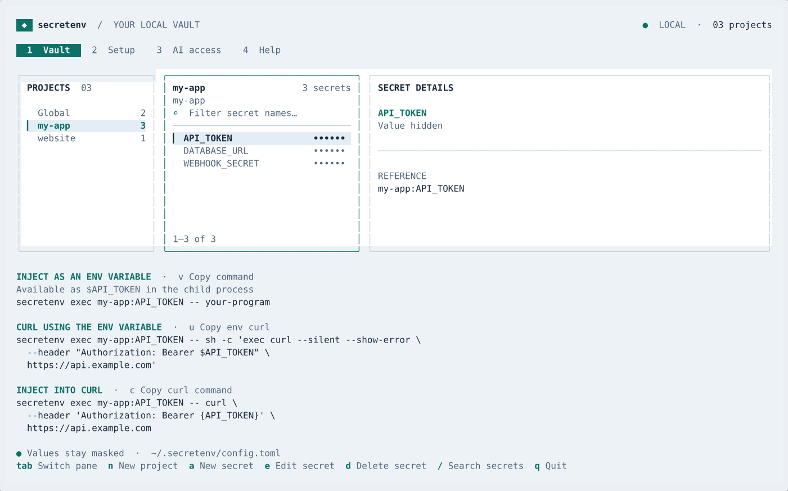

# secretenv

[](https://github.com/adam-ah/env-secret-manager/actions/workflows/ci.yml)

**Let AI tools use your secrets without printing their values.** A local Go vault with a terminal editor, command injection, and output redaction.

## See it work

From an agent session, shortened:

```text
You: use it to call openrouter luna 6 to say hi :)
Agent runs: secretenv exec OPENROUTER_KEY -- curl ...
Agent: Hi! :)

You: show me the key you used
Agent: I used OPENROUTER_KEY. secretenv kept its value hidden from me.
```

[](demo.gif)

## Start

Requires Go 1.22+ and a C compiler for race tests.

```sh
./build.sh
./bin/secretenv
```

Add a secret in the editor, then run:

```sh
./bin/secretenv list --current
./bin/secretenv exec OPENAI_KEY -- your-program
./bin/secretenv exec my-app:SAMPLE_SECRET -- curl \
  --header 'Authorization: Bearer {SAMPLE_SECRET}' \
  https://api.example.com
```

`KEY` selects Global; `PROJECT:KEY` selects a project. Both inject the child env variable `KEY`. Add multiple references before `--`. Use `{KEY}` to insert a value into an argument. Selected values are redacted from stdout and stderr.

`secretenv install [bash|zsh]` prints optional hook setup to load project variables by folder. It changes no files. Global never auto-injects.

Secrets live in plaintext at `~/.secretenv/config.toml`. Filtering prevents accidents; files, encodings, and other channels can bypass it.

[Full usage](docs/usage.md) · [Agent skill](skills/secretenv/SKILL.md) · [Releases](https://github.com/adam-ah/env-secret-manager/releases)

## Build & release

`./build.sh` runs `./test.sh` before compiling. GitHub Actions tests Linux/macOS; pushing a `v*` version tag publishes Linux/macOS Intel and ARM archives, checksums, and release notes.
