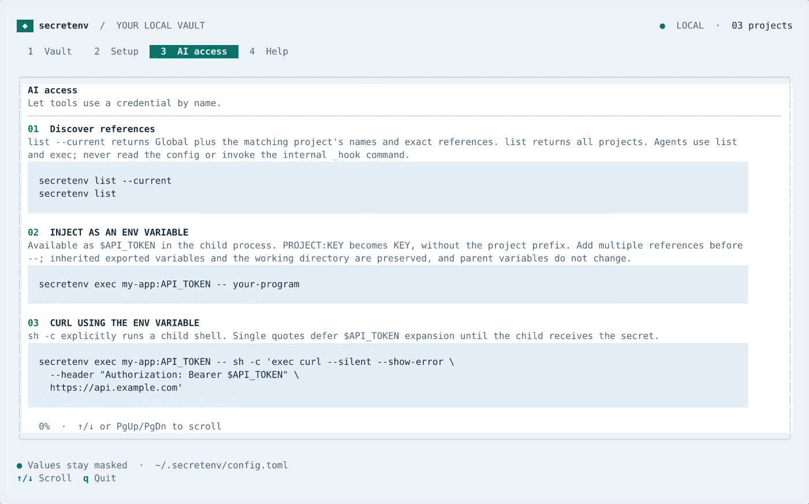
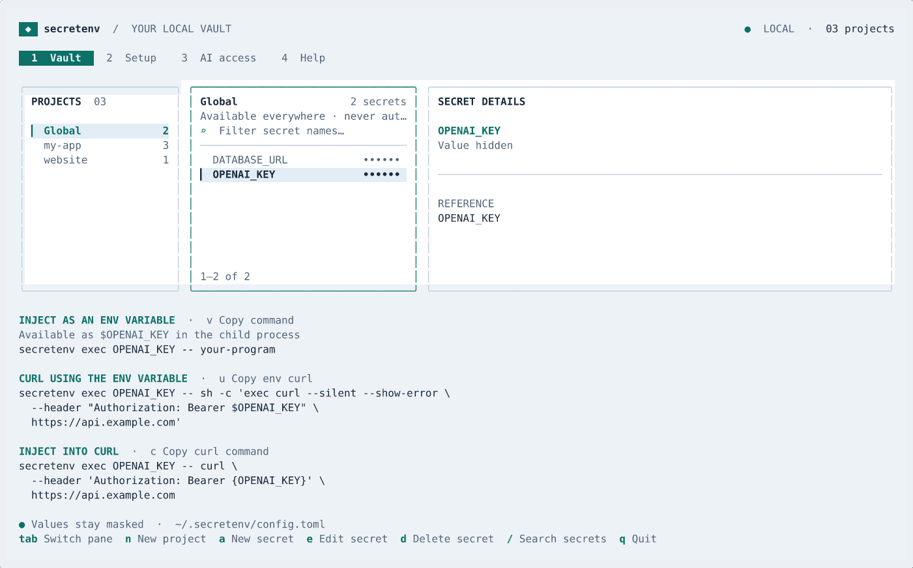

# Usage and development

## Execute with secrets

Discover names and exact references:

```sh
secretenv list --current
secretenv list
```

`--current` returns Global plus the matching project. Without it, `list` returns all projects. Output contains names, never values:

```json
[
  {"project":"Global","scope":"global","secrets":["OPENAI_KEY","DATABASE_URL"],"references":["OPENAI_KEY","DATABASE_URL"]},
  {"project":"my-app","scope":"project","secrets":["SAMPLE_SECRET"],"references":["my-app:SAMPLE_SECRET"]}
]
```

### Inject as an env variable

Available as `$SAMPLE_SECRET` in the child process:

```sh
secretenv exec my-app:SAMPLE_SECRET -- your-program
```

Each selected key becomes a child environment variable. Bare keys read Global; `PROJECT:KEY` reads that exact project. References work from any directory. Selected values override inherited values in the child only. The rest of the exported environment and the working directory are preserved. Duplicate variable names are rejected. The parent shell is unchanged.

Replace `your-program` with the executable that needs the credential. To inject several variables, use `secretenv exec OPENAI_KEY DATABASE_URL my-app:SAMPLE_SECRET -- your-program`.

### Curl using the env variable

```sh
secretenv exec my-app:SAMPLE_SECRET -- sh -c 'exec curl --silent --show-error \
  --header "Authorization: Bearer $SAMPLE_SECRET" \
  https://api.example.com'
```

The single quotes keep `$SAMPLE_SECRET` for the child shell to expand after injection. `sh -c` is explicit because shell variable expansion needs a shell. The project prefix is never part of the environment variable name.

### Inject into curl

For programs that need a secret in an argument, use `{KEY}`:

```sh
secretenv exec my-app:SAMPLE_SECRET -- curl \
  --header 'Authorization: Bearer {SAMPLE_SECRET}' \
  https://api.example.com
```

All selected secrets are still available as environment variables, even if used in arguments. Only selected `{KEY}` placeholders are substituted, literally and without recursive expansion. This example executes curl directly. For shell syntax or `$KEY` expansion, explicitly launch a shell as shown in the env curl example.

## Output filtering

Both stdout and stderr replace literal injected values with `[REDACTED]`, including values split across writes:

```sh
secretenv exec OPENAI_KEY -- printenv OPENAI_KEY
```

prints `[REDACTED]`. Ordinary output streams through normally. Child exit codes are preserved. Empty values are injected as empty variables without attempting empty-string replacement. Missing references, duplicate names, missing programs, and values containing NUL bytes fail before execution. Raw `get` is removed; values are never returned directly.

Filtering is an accidental-disclosure guard. It covers requested secrets on the standard output streams. Files, encoded/transformed values, direct terminal access, other channels, and inherited secrets not selected here can bypass it. Argument injection can expose values in process listings; prefer environment variables when a program supports them. This is not an isolation boundary against malicious code.

`secretenv --help` is a short command reference with the same examples as the workspace. The [secretenv skill](../skills/secretenv/SKILL.md) gives agents the workflow. Agents use `list` and `exec`; never read the config or invoke the internal `_hook` command.

To install the skill for Codex from this clone or a release archive:

```sh
mkdir -p ~/.codex/skills
cp -R skills/secretenv ~/.codex/skills/
```

Use `$CODEX_HOME/skills` instead if you have configured a custom Codex home.

## Terminal workspace

The Vault tab has a project sidebar, compact secret list, and a reference inspector on wide terminals. Copyable examples sit below the panes and name the injected environment variable: `v` copies environment injection, `u` copies curl using the child environment, and `c` copies curl using argument substitution. Short terminals show a copy shortcut for the extra env curl example. The clipboard receives the complete command, even if a long line is shortened on screen.

The footer shows available actions once, with labels specific to the active pane. `n` creates a **new project**; `a` creates a **new secret**. On the project pane, `e` renames the project; on the secret pane, it edits the secret. `d` deletes after confirmation. Global cannot be renamed or deleted, but its secrets can.

`Tab` switches panes; arrows or `j`/`k` move the selection; `/` searches secret names; `q` quits. In forms, `Ctrl+S` saves and `Esc` cancels. Existing values remain masked. Replacing a value requires confirmation.

Tabs `1`–`4` open Vault, Setup, AI access, and Help. The interface uses Bubble Tea and Lip Gloss and requires at least 64×24 cells. Startup, `menu`, and `edit` print agent-focused help unless both input and output are terminals with cursor support. Explicit `list` and `exec` commands still run normally in scripts and agent sessions.



<details>
<summary>Watch the workspace demo</summary>



</details>

New project names accept letters, numbers, `.`, `_`, `-`, `/`, and `:`; they cannot start with `-`. `Global` is reserved. Spaces, quotes, tilde, backslashes, and shell symbols are rejected so new references can be typed without quotes. Safe absolute paths work. Secret keys use shell variable syntax: letters, numbers, and underscores, starting with a letter or underscore. `SECRETENV_ACTIVE_*` is reserved.

## Config and optional shell integration

Secrets live in `~/.secretenv/config.toml`, outside project trees:

```toml
[global.env]
OPENAI_KEY = "replace-in-the-editor"

[projects."my-app".env]
SAMPLE_SECRET = "replace-in-the-editor"

[projects."/srv/code/another-app".env]
API_TOKEN = "another-token"
```

Global is stored separately from projects and is excluded from directory matching and automatic exports. Project folder names match that directory segment and its children; absolute paths match that path and its children. Matching is case-insensitive and prefers more specific paths. Explicit references use the exact configured name. Existing hand-written selectors with `~/` remain readable; new editor names follow the rules above.

The editor writes atomically, using directory permissions `0700` and file permissions `0600`. Storage is plaintext and readable by programs running as your OS user.

Print the folder-based shell hook setup:

```sh
secretenv install zsh
secretenv install bash
```

`install` only tells you what to do; it changes no files. Add the printed hook to `~/.zshrc` or `~/.bashrc`, then open a new shell. The hook uses an internal `_hook` command to load matching project variables and clear managed variables when you leave. Global is never automatically injected. There is no public `export` command. Start AI sessions without hooks or inherited project secrets.

## Development

```sh
./test.sh
./build.sh
```

`test.sh` checks formatting, verifies module downloads, runs all tests with the race detector, and runs `go vet`. `build.sh` runs `test.sh` before building; failed checks stop the build. Neither script modifies module files.

Tests cover multi-secret injection, environment inheritance, argument substitution, filtering across chunk boundaries on both streams, child exit codes, Global scope, editor validation, and shell syntax in copyable examples. `TestNoCommentsInGoCode` rejects comments in repository Go files, including tests; comment-like text in strings is allowed.

GitHub Actions runs the build on Linux with Go 1.22 and the current stable Go, and on macOS with stable Go. Each job uploads its binary and checks noninteractive startup help.

To publish a release after committing and pushing changes:

```sh
git tag v0.2.0
git push origin v0.2.0
```

Version tags trigger the same tests first, then build Linux and macOS archives for `amd64` and `arm64`, generate checksums, and publish a GitHub release with generated notes. Tags such as `v0.2.0-rc.1` produce prereleases. No extra repository secrets are needed. To test packaging locally without publishing, run `./release.sh v0.2.0`; output goes to `dist/v0.2.0/`.

To refresh the screenshots and demo, install asciinema's `agg` and `ffmpeg`, then run `./render.sh`. Rendering uses fake fixture data and never reads your secrets config.
